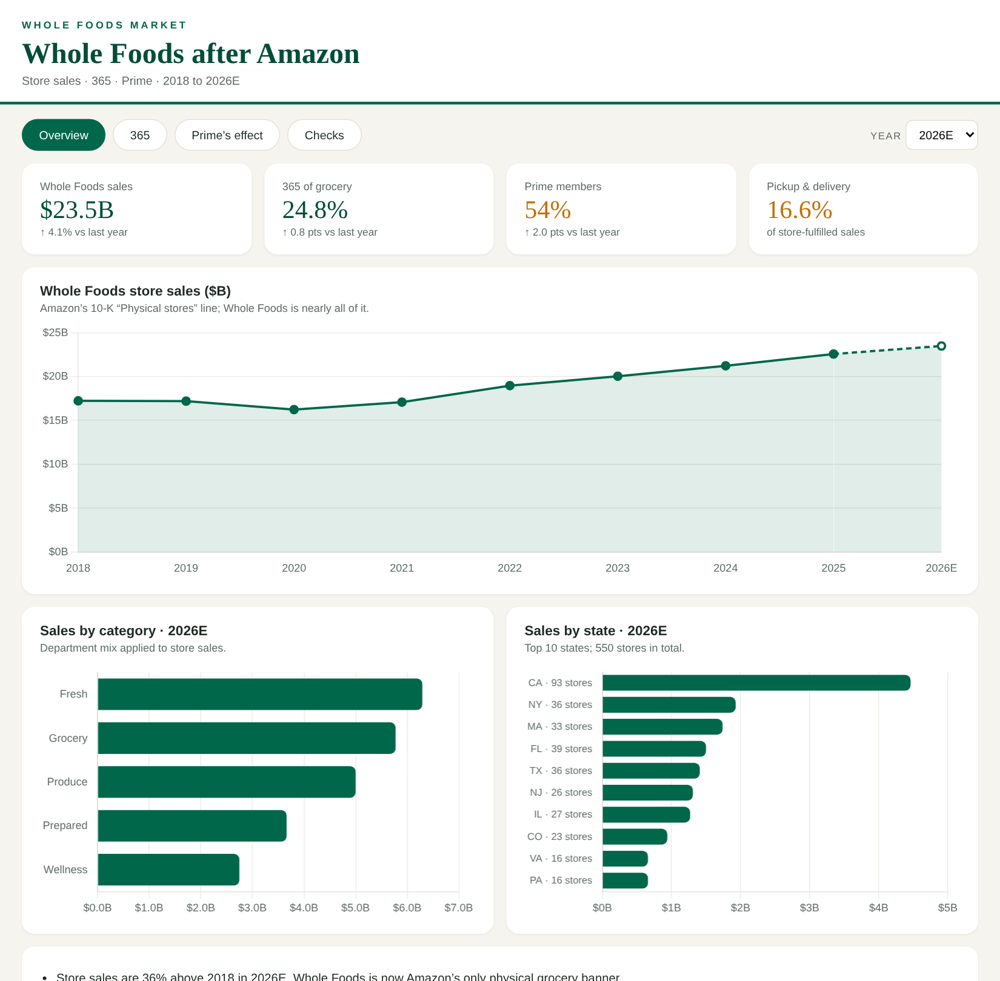
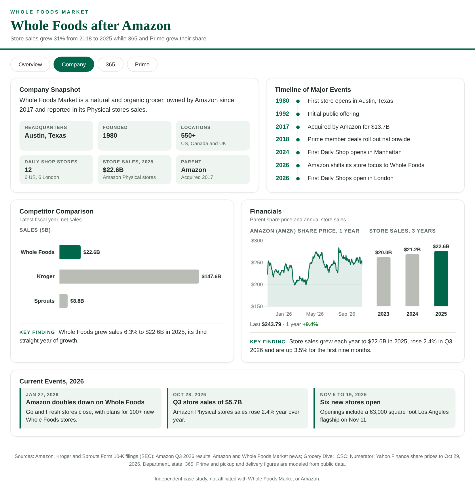
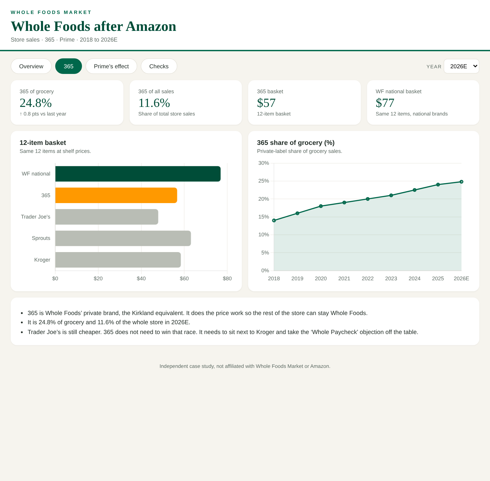
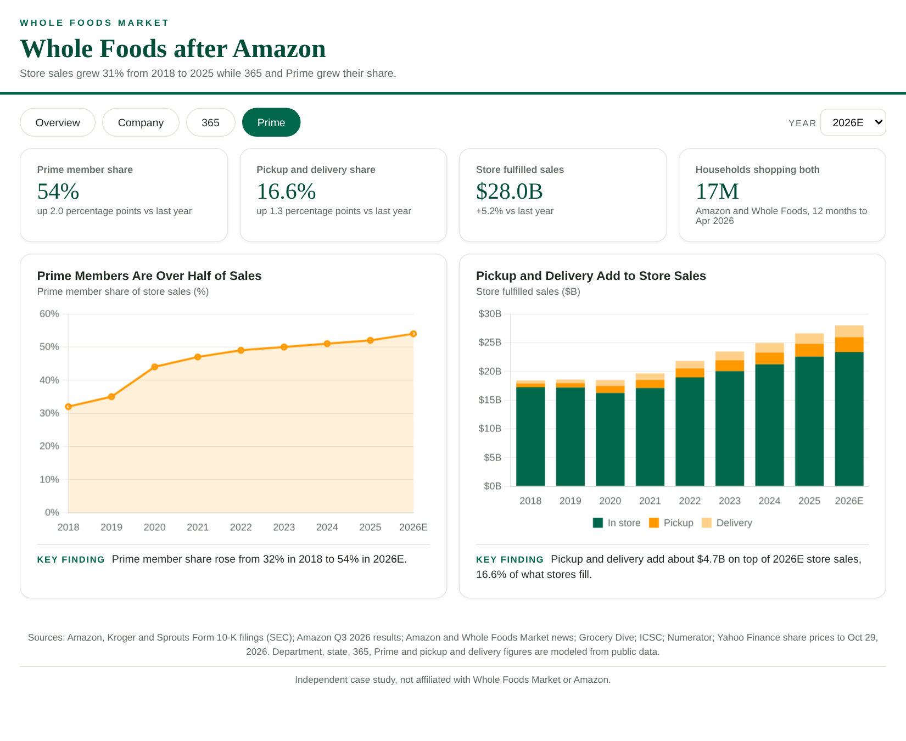

**Live dashboard:** https://rituneupane.github.io/whole-foods-after-amazon/

# Whole Foods after Amazon

Store sales grew 31% from 2018 to 2025 while 365 and Prime grew their share. Built from Amazon's 10-K Physical stores line, Amazon and Whole Foods Market news, and a modeled operating view.

Independent case study, not affiliated with Whole Foods Market or Amazon. Not a stock pick.

## Key findings

- Store sales went from **$17.2B** (2018) to **$22.6B** (2025), up 6.3% in 2025, and are on pace for about **$23.3B** in 2026 based on the first nine months (Q3 2026 store sales $5.7B, up 2.4%).
- **365** grew from 14% of grocery sales in 2018 to **24.8%** in 2026E. A 12 item 365 basket costs **$57**, about 26% less than the same items in national brands ($77).
- **Prime members** are about **54%** of store sales in 2026E, up from about a third in 2018. Pickup and delivery add about **$4.7B** on top of store sales.
- In 2026 Amazon closed its Go and Fresh stores to focus on Whole Foods, with plans for **100+** new stores, and the Daily Shop format reached **12** locations in the US and London.

## Dashboard tabs

| Tab | What it shows |
|---|---|
| Overview | KPIs vs last year, store sales 2018 to 2026E, sales by department, top 10 states |
| Company | Snapshot, timeline of major events, peer sales view (Kroger, Sprouts), Amazon 1 year share price, 3 year store sales, 2026 current events |
| 365 | 365 share of grocery, 12 item basket vs national brands |
| Prime | Prime member share, store fulfilled sales including pickup and delivery |

**Overview**



**Company**



**365**



**Prime**



## Data

Store sales follow Amazon's 10-K **Physical stores** line. Whole Foods is nearly all of it. Department mix, 365 share, Prime share, pickup and delivery, state sales and the basket are modeled from public store counts and grocery research. Detail: [`data/SOURCES.md`](data/SOURCES.md).

**2026E method.** 2026E = first nine months 2026 Physical stores ($17,289M: Q1 $5,785M, Q2 $5,794M, Q3 $5,710M, Amazon Q3 2026 results) × FY2025 / first nine months 2025 ($22,561M / $16,706M) = **$23.35B**, +3.5%.

## Files

```
data/wfm_annual.csv        10-K store sales, stores, 365, Prime
data/category_mix.csv      five departments by year
data/prime_channel.csv     Prime share; 10-K in store sales plus modeled pickup and delivery
data/state_sales.csv       top states
data/price_basket.csv      12 item basket
data/SOURCES.md            filing vs modeled
analysis/build.py          tie-out tests, writes docs/data.js
analysis/notes.md          takeaways
docs/                      live dashboard (index.html, data.js, company.js)
screenshots/               one image per tab
```

Rebuild the data file with `python analysis/build.py`. MIT License.
